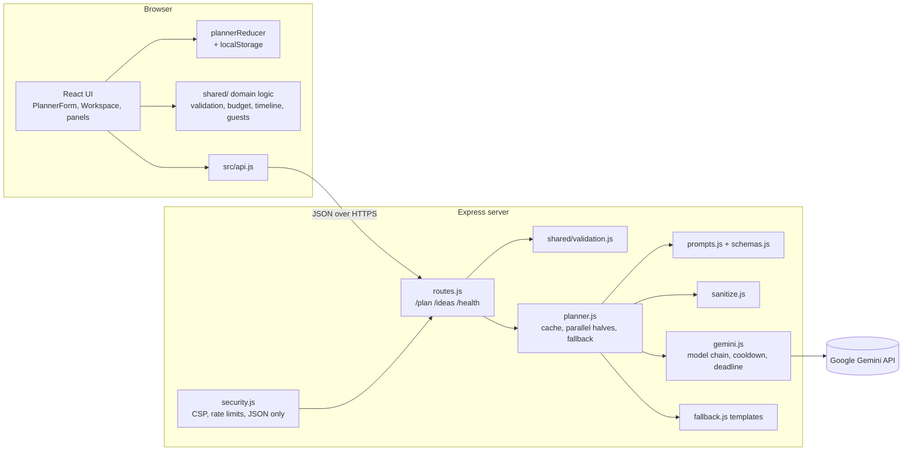

# Festa — Gemini-powered celebration & event planner

Festa turns a two-minute brief ("a wedding in Jaipur for 180 guests, ₹15 lakh, marigold and pastel") into a living plan you can actually run: a budget split you can track spend against, a week-by-week checklist with priority alerts, a day-of run of show, a vendor checklist, an RSVP and dietary tracker with seating suggestions, and a creative studio for decor, playlists, icebreakers, invitations and vendor emails.

Built for **PromptWars Virtual — Challenge 5: Celebration & Event Planner**.

## How it covers the brief

| Pillar                         | What Festa does                                                                                                                                                                                                                     | Where                                     |
| ------------------------------ | ----------------------------------------------------------------------------------------------------------------------------------------------------------------------------------------------------------------------------------- | ----------------------------------------- |
| Intelligent event blueprinting | Event type, guests, budget, currency, city, vibe and notes become a tailored master plan. A free-text "Change something about the plan" box regenerates it ("make it eco-friendly and cut 15% from decor").                         | `PlannerForm.jsx`, `server/ai/prompts.js` |
| Smart budgeting                | Gemini splits the budget across 8 categories with a reason for each line and savings tips. Hosts edit planned amounts, log actual spend, see over-budget alerts, and rebalance to a new total while keeping the proportions.        | `BudgetPanel.jsx`, `shared/budget.js`     |
| Timeline & milestones          | Tasks are scheduled backwards from the event date. If the ideal date has already passed, the task is compressed to today. It shows overdue / due-this-week / high-priority alerts, a progress bar, filters and a timed run of show. | `TimelinePanel.jsx`, `shared/timeline.js` |
| Guests & invitations           | RSVP and dietary tracking with plus-ones, a caterer summary, group-aware seating (bin packing), invitation wording in four tones, and activity ideas tuned to the RSVP mix.                                                         | `GuestsPanel.jsx`, `shared/guests.js`     |
| GenAI creativity engine        | Decor concepts with palettes, playlists of real songs mapped to moments, icebreakers, guest activities, invitations, and vendor enquiry emails (one click from any vendor). Every idea has a copy button.                           | `IdeasPanel.jsx`, `VendorsPanel.jsx`      |

## Gemini integration

- **SDK:** `@google/genai`, called server-side only (`server/ai/gemini.js`). The API key never reaches the browser.
- **Structured output:** every call uses `responseMimeType: application/json` plus `responseJsonSchema` (`server/ai/schemas.js`), so responses match the exact shape the UI renders.
- **Parallel generation:** the master plan is two smaller calls run in parallel: _overview_ (summary, theme, budget, risks) and _schedule_ (milestones, run of show, vendors). This roughly halves the wait.
- **Resilience:** a model chain (`gemini-3.8-flash → gemini-3.5-flash-lite → gemini-3.6-flash` by default) with per-call timeouts, an overall deadline, and a 60-second cooldown for models that just failed. Retired models are skipped for good, and auth errors stop at once. If Gemini is down, each half falls back to a deterministic template independently, and the UI labels the result honestly: _Gemini_, _partial_ or _template_.
- **Prompt engineering:** derived facts (days until the event, budget per guest, maximum weeks available) are computed in code and given to the model. User text travels only inside an `<event_data>` JSON block, with `<` escaped so it cannot close the block. The system prompt tells the model to treat that block as data.

## Architecture



The same `shared/` modules run in the browser (instant feedback, local budget maths and seating) and on the server (authoritative validation). Every external dependency, such as the Gemini client, the clock, the cache and the logger, is injected, so each layer can be tested on its own.

## Engineering notes

**Code quality:** small, single-purpose modules. The server is split into config, security, routes, client serving and errors; the UI into focused components, hooks (`useLatestRequest`, `usePlanInsights`, `usePlanner`) and named action creators. Shared JSDoc types (`shared/types.js`) are checked across the whole codebase with `npm run typecheck`. Prettier and EditorConfig keep formatting consistent; oxlint runs with warnings treated as errors. A GitHub Actions workflow runs format, lint, type check, tests with coverage thresholds, build and audit on Node 22 and 24.

**Security:** see [SECURITY.md](SECURITY.md). Helmet with a strict CSP (`script-src 'self'`, `frame-ancestors 'none'`) and a Permissions-Policy; per-client rate limits (120/min on the API, 15/min on generation); a 16 KB body limit; JSON-only request bodies; request timeouts; and shared validation that runs on both the client and the server. Model output is treated as untrusted: text is clamped, lists bounded, enums enforced, and budget arithmetic recomputed. There is no `dangerouslySetInnerHTML` (lint-enforced), and palette colours are applied only if they match `#rrggbb`. Errors never expose stack traces. Only aggregate, name-free guest counts are ever sent to the AI, and saved browser state is validated key by key on load.

**Efficiency:** a TTL LRU cache for identical briefs. Budget rebalancing, alerts, seating and RSVP stats run locally, with no AI round trip. Requests are aborted when a newer one supersedes them. Budget inputs commit on blur, and localStorage writes are debounced. Static assets are immutable and cached for a year, with gzip compression. Runtime dependencies: React, Express, the Gemini SDK, lucide icons and three small middlewares.

**Accessibility:** semantic landmarks and a skip link; WAI-ARIA tabs with arrow/Home/End keys; every input labelled, with errors linked through `aria-describedby`; focus moves to the first invalid field and to the plan heading when a plan arrives; live regions for progress and changes; 44 px touch targets; visible focus rings; `prefers-reduced-motion` and `forced-colors` support; and the Atkinson Hyperlegible body typeface, designed for low-vision readers. axe-core runs in the test suite. Print styles produce a complete paper or PDF plan.

**Testing:** 163 Vitest tests across 14 files, with about 98% line coverage enforced by thresholds in `vite.config.js`. They cover:

- the shared domain logic;
- config parsing;
- the Gemini client (fallback, cooldown, deadline, parsing);
- prompt-injection containment;
- output sanitising;
- the planner (parallel halves, caching, partial fallback);
- the real HTTP stack: validation, security headers, 413, 415, 429, malformed JSON, hidden 500s, and static asset caching;
- the client API wrapper (timeouts, aborts, unreachable server);
- the hooks (request cancellation, debounced persistence, blocked storage);
- the reducer, including tampered storage;
- components;
- full UI flows (refine, start over, copy, privacy of guest data) with axe-core accessibility audits.

## Project structure

```
shared/            Pure domain logic used by client and server
  types.js         JSDoc types for the domain model
  validation.js    One validator for both layers
  budget.js        Allocation, rebalancing, budget summary
  timeline.js      Due dates, statuses, alerts
  guests.js        RSVP stats, seating
server/
  index.js         Entry point: config, wiring, timeouts
  app.js           Composes the Express app from injected dependencies
  config.js        Environment parsing with safe defaults
  http/            security.js, routes.js, client.js (static files), errors.js
  ai/              gemini.js (client), prompts.js, schemas.js
  services/        planner.js (orchestration), sanitize.js, fallback.js
  lib/cache.js     TTL LRU cache
src/
  App.jsx          Shell: brief form or workspace
  api.js           Fetch wrapper with user-facing errors
  state/           plannerReducer.js + actions.js
  hooks/           useLatestRequest, usePlanInsights, usePlanner
  lib/format.js    Dates, countdown, swatches, vendor matching
  components/      Panels, plus guests/, ideas/ and workspace/ sub-components
tests/             shared/, server/, client/ (Vitest + Testing Library + axe-core)
```

## Run locally

```bash
npm install
cp .env.example .env          # add GEMINI_API_KEY from https://aistudio.google.com/apikey
npm run dev                   # API on :8787 + Vite on http://localhost:5173 (hot reload)
# or run the production build:
npm run build && npm start    # http://localhost:8787
npm test                      # unit, integration and accessibility tests
npm run check                 # everything CI runs: format, lint, types, coverage, build
```

The app also runs with no API key: plans then come from the built-in starter templates.

## Deploy (Render)

`render.yaml` is a ready blueprint: connect the repo, set `GEMINI_API_KEY`, and deploy. The health check is `/api/health`.
